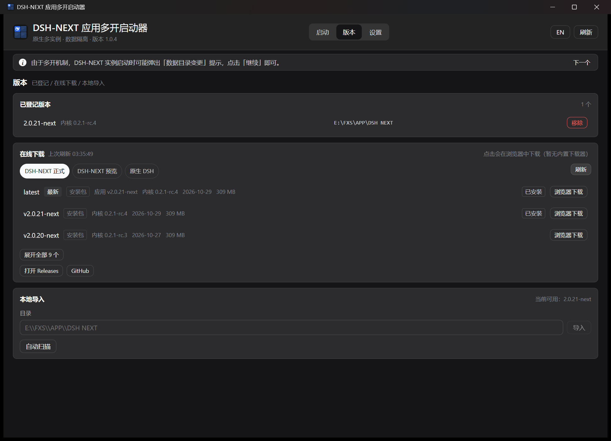
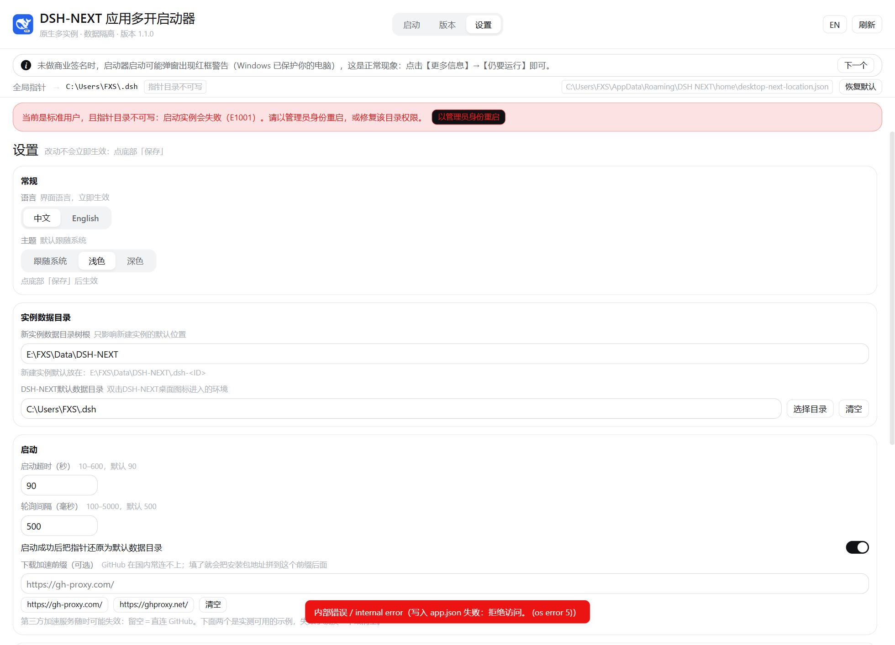
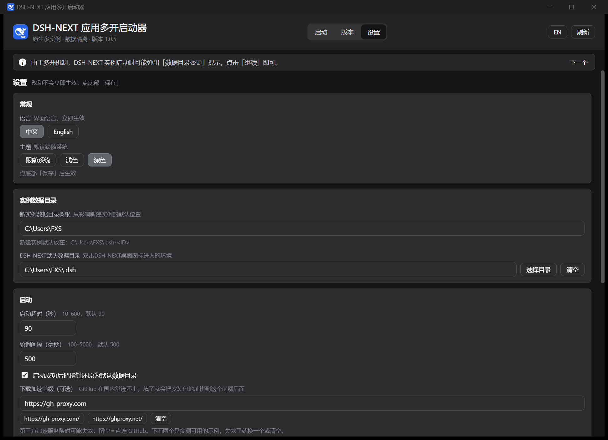

# DSH-NEXT 应用多开启动器


我在 DSH 里养了条「deepseek 大肥鱼」，叫**汐**。

我想要汐的 DSH 和我工作自用的 DSH **完全数据隔离**——不是只隔离插件，而是连记忆、会话、凭据都不互相污染。
但 DSH-NEXT 的全局指针同一时刻只能指向一个数据目录，而官方的 profile 切换**只隔离插件**，会话与插件存储仍然混在一起。

所以我做了这个启动器：**每个实例一个完整独立的数据目录**，给汐一个只属于它的家。
它就是同一份 DSH-NEXT 安装跑出的多个原生窗口——真窗口、真托盘、真 Community Market，不是 webview 套壳。

> 简称「**NUL 启动器**」（图标右下角的下标即 NUL）。

[](https://github.com/XinSpark/dsh-next-multi-launcher/actions/workflows/ci.yml)
[](LICENSE)
[](#平台支持)


## 它多开的是什么：DSH-NEXT

本启动器**不包含** DSH，也不修改它——它只是把你自己装好的 DSH-NEXT 起成多个独立窗口。
先有 DSH-NEXT，才有这个工具。

| 名称 | 是什么 | 去哪拿 |
|---|---|---|
| **DSH**（DeepSeek Harness） | 上游内核 | [deepseek-ai/deepseek-harness](https://github.com/deepseek-ai/deepseek-harness) |
| **DSH-NEXT** | DSH 的桌面发行版，**本启动器针对它** | [官网 dshdesktop.cn](https://www.dshdesktop.cn/) · [Releases](https://github.com/anywhere-labs/dsh-desktop/releases) |
| **原生 DSH 桌面端** | 官方直链版本 | [下载地址](https://download.deepseek.com/desktop/dsh-latest-windows-x64.exe) |

- 版本页可在线下载 **DSH-NEXT 正式 / 预览** 与 **原生 DSH** 三个渠道，也能导入已解包的安装目录；
- **原生 DSH 只支持「登记 + 启动」，不支持多开与版本导入**——它没有 DSH-NEXT 的那套指针机制，启动器里会明确提示；
- 没有任何账号体系或云端依赖：本工具只在你的机器上读写文件，联网仅用于查版本与下载安装包。

## 隔离范围：比官方 profile 多了什么

| 层 | 官方 profile 切换 | 本启动器（独立 home） | 证据 |
|---|---|---|---|
| 插件 | ✅ 隔离 | ✅ 隔离 | `plugins/`、`profiles/` 在 home 内 |
| **会话** | ❌ 仍会互相看到 | ✅ **文件级隔离** | `sessions/` 在 home 内（按 workspace 分组） |
| **插件存储** | ❌ 共享 | ✅ 隔离 | `storages/` 在 home 内 |
| **凭据** | ❌ 共享 | ✅ 隔离 | `.credentials.yaml` 在 home 内 |
| 单实例锁 | — | ✅ 两把不同的锁 | 独立 `userData` = `<home>\electron-user-data` |
| Agents Anywhere 账号 | ❌ | ❌ 设备绑定是全局的 | 见[能力边界](#能力边界) |
| 内核版本 | ❌ | ❌ 壳与内核恒同版本 | 同上 |

一句话：**官方实例隔离到插件层，本工具隔离整个 home。**

## 特性

| 能力 | 说明 |
|---|---|
| **多实例** | 每个实例独立名称、ID、home、DSH-NEXT 版本；归档、删除、备注 |
| **串行启动队列** | 同一时刻只启动一个，避免指针互相覆盖；失败自动回滚 |
| **启动后还原** | 成功后把指针还原为默认环境，双击桌面图标仍进日常 |
| **版本树** | 目录链接（junction）登记已解包安装目录，不复制文件（省 300MB/版本） |
| **自动扫描** | 导入版本时自动发现本机安装（快捷方式 / 注册表 / 常见路径 / 运行中进程），勾选批量导入 |
| **初始化向导** | 首次启动五步：语言 → 环境体检 → 默认数据目录树根 → 选版本 → 实例；可跳过、可重跑 |
| **在线下载** | `latest` 与历史版本（实时解析，标注内核版本），默认只列 3 条；可选 GitHub 加速前缀 |
| **重启** | 「重启 / 重启并进入安全模式 / 重启并退出安全模式」，安全模式可识别 |
| **停止** | 优雅退出 → 超时 → 强制结束整组（含 host 子进程） |
| **权限** | 关键目录不可写时自动请求管理员，界面可手动触发 |
| **原生对齐** | 1158 个设计 token 从 `app.asar` 抽取，门禁防漂移 |
| **可验证** | 70 项 Rust 单测、15 项端到端断言、UI 自动化检查 |

## 界面

三视图：`启动 / 版本 / 设置`（`#launch` / `#versions` / `#settings` 可深链）。

版本页：`latest` 与历史版本实时解析并标注内核版本，默认只列 3 条；`刷新` 与在线状态共享一次拉取
（启动时一次，之后每 10 分钟一次，其余手动）。



首次启动的初始化向导：语言 → 环境体检 → 默认数据目录树根 → 选版本 → 实例。





## 快速开始

1. 准备 DSH-NEXT（目录里要有 `DSH NEXT.exe` 与 `resources\app.asar`）；
2. 运行启动器（[Releases](https://github.com/XinSpark/dsh-next-multi-launcher/releases) 下载，或从源码构建）；
3. 点「导入版本」→「**自动扫描**」（或手动选目录）→「新建实例」→「启动」。

> 自动扫描覆盖正常安装（快捷方式、注册表、常见路径）与正在运行的实例；
> 解压到任意目录的绿色版可能扫不到，用「浏览」手动选即可。

> 未购买商业代码签名，首次运行可能看到 SmartScreen 提示——点「更多信息 → 仍要运行」。
> 校验方式见[关于代码签名](#关于代码签名)。

## 核心概念

| 概念 | 含义 |
|---|---|
| **指针** | DSH-NEXT 的全局文件，决定下次启动进哪个数据目录；启动器临时改写并在成功后还原 |
| **home** | 实例的完整数据目录。默认 `<数据目录树根>\.dsh-<id>`，可自由修改 |
| **默认环境** | 设置里的「默认数据目录」；双击桌面图标应进入的环境 |
| **版本树** | `versions\<tag>` 目录链接，指向已解包的 DSH-NEXT 安装目录 |
| **实例** | 名称 + ID + home + 版本的组合，存为 `instances\<id>.json` |

## 使用

### 列表与详情

实例行给出状态（运行中 / 已停止 / 排队 / 失败）、版本、home 与上次启动时间；
选中后在右侧改名称、版本、home、备注。

### 重启（两处入口）

实例行与详情面板底部各有一个「重启 ▾」，都在【启动/停止】**之前**，**两项**：
「重启」+ 按当前状态二选一（进入 / 退出安全模式）。

重启期间顶部显示「正在重启「X」…」；实例运行在安全模式时，顶部常驻提示条并带「退出安全模式」按钮。

### 顶部提示（单行轮播）

指针栏下方有一条常驻提示，单行轮播、每条 30 秒：重启限制与「数据目录变更」提示的说明。

## 能力边界

**能保证**：整套 home 隔离（会话 / 插件 / 凭据 / 插件存储 / 窗口状态按 home 各一份）；
多实例同时运行互不抢锁；启动失败一律回滚指针；删除数据目录前有安全网。

**不保证**：

| 项 | 说明 |
|---|---|
| Agents Anywhere 账号隔离 | 切 home 不隔离 AA 登录与设备绑定，跨实例共享 |
| 内核独立 | 壳与 `@deepseek-ai/dsh` 恒同版本，只有"壳版本"一个旋钮 |
| 同 home 多实例 | 两个 writer 会损坏会话；启动器直接拒绝（E1003） |
| 非默认实例在 DSH 内部重启 | 会重读全局指针，落到默认实例；重启请用启动器「重启 ▾」 |
| 多个非默认实例同时运行时的重启 | 指针全局唯一，只有最后启动的那个能正确重启 |
| 自动更新管理 | 只提示风险，不改 `app-update.yml`，不写注册表 / 快捷方式 |
| SmartScreen 红色拦截 | 自签名无效，需 EV 证书或信誉积累 |

## 平台支持

**当前仅支持 Windows**。发布者只有 Windows 环境，DSH-NEXT 的实际使用场景也在 Windows。

跨平台并非架构限制——前端与 Tauri 都跨平台，阻塞在 Rust 侧的 Windows 假设
（`#[cfg(windows)]` 8 处、路径分隔符、`%APPDATA%` 等）。如果你有对应环境并愿意适配，
欢迎提交 PR，清单见 [CONTRIBUTING](CONTRIBUTING.md#跨平台适配)。

## 关于代码签名

本项目**当前不购买商业代码签名证书**。首次运行可能看到两道提示：

| 现象 | 原因 | 处理 |
|---|---|---|
| 「Windows 已保护你的电脑」 | 无信誉、无 EV 证书 | 点「更多信息 → 仍要运行」 |
| 「无法验证发布者」 | 证书链不受你机器信任 | 同上，或用 SHA256 校验 |

```powershell
Get-FileHash .\DSH-NEXT-Multi.exe -Algorithm SHA256
# 与 Release 页面上的 SHA256 逐字符比对
```

不想看到任何提示：从源码构建（`pnpm tauri build --no-bundle`）。

长期方案：不签名（当前，0 成本）→ [SignPath Foundation](https://signpath.org/)（开源免费，解决 UAC）→ EV 证书（约 ¥2300/年，零提示）。
维护者本机自签名：`pnpm sign`（仅自己机器有效）。

## 文档

| 想看什么 | 去哪 |
|---|---|
| 全部文档导航 | [docs/README.md](docs/README.md) |
| 设计与取舍 | [docs/design.md](docs/design.md) |
| 初始化向导（已实现） | [docs/design-onboarding.md](docs/design-onboarding.md) |
| 架构与数据流 | [docs/reference/architecture.md](docs/reference/architecture.md) |
| 数据格式（`app.json` / 实例 / 指针） | [docs/reference/data-format.md](docs/reference/data-format.md) |
| 版本兼容性与依赖契约 | [docs/reference/compatibility.md](docs/reference/compatibility.md) |
| 错误码 `E1000`–`E1013` | [docs/reference/error-codes.md](docs/reference/error-codes.md) |
| 配置项与环境变量 | [docs/guide/configuration.md](docs/guide/configuration.md) |
| 故障排查 | [docs/guide/troubleshooting.md](docs/guide/troubleshooting.md) |
| 踩过的坑（症状→根因→证据） | [docs/experience/](docs/experience/README.md) |
| 验收记录 | [docs/testing.md](docs/testing.md) |

## 构建与测试

环境：Node ≥ 20、pnpm ≥ 10、Rust ≥ 1.77（MSVC）、WebView2。

```powershell
pnpm install
pnpm tauri dev                    # 开发
pnpm check                        # svelte-check（0 error 是门槛）
pnpm verify                       # 设计 token 门禁
pnpm lint:css                     # 样式门禁（禁 hex / 圆角只用 token / 字号成对 / 字重）
cargo test --manifest-path src-tauri/Cargo.toml
node tools/e2e.mjs                # 端到端（替身进程，15 项断言）
node tools/check-links.mjs        # 文档链接校验
pnpm tauri build --no-bundle      # 出 exe
```

## 发布（维护者）

```powershell
# 1) 三处版本号一致：package.json / src-tauri/Cargo.toml / tauri.conf.json
# 2) 构建并复制便携 exe
pnpm tauri build --no-bundle
Copy-Item src-tauri\target\release\DSH-NEXT-Multi.exe . -Force
# 3) 可选：本机自签名（仅自己机器不提示，对外无效）
pnpm sign
# 4) 打 tag
git tag -a v1.0.0 -m "v1.0.0"
```

> 换图标后必须 `cargo clean -p dsh-next-multi-launcher --release` 再构建，
> 否则 exe 内嵌图标不会更新（见 [docs/experience/04-图标与缓存.md](docs/experience/04-图标与缓存.md)）。

## 贡献

见 [CONTRIBUTING.md](CONTRIBUTING.md)。安全问题请按 [SECURITY.md](SECURITY.md) 私下报告。

## 许可

[MIT](LICENSE)。DSH-NEXT 本身的许可与版权归其作者所有。
