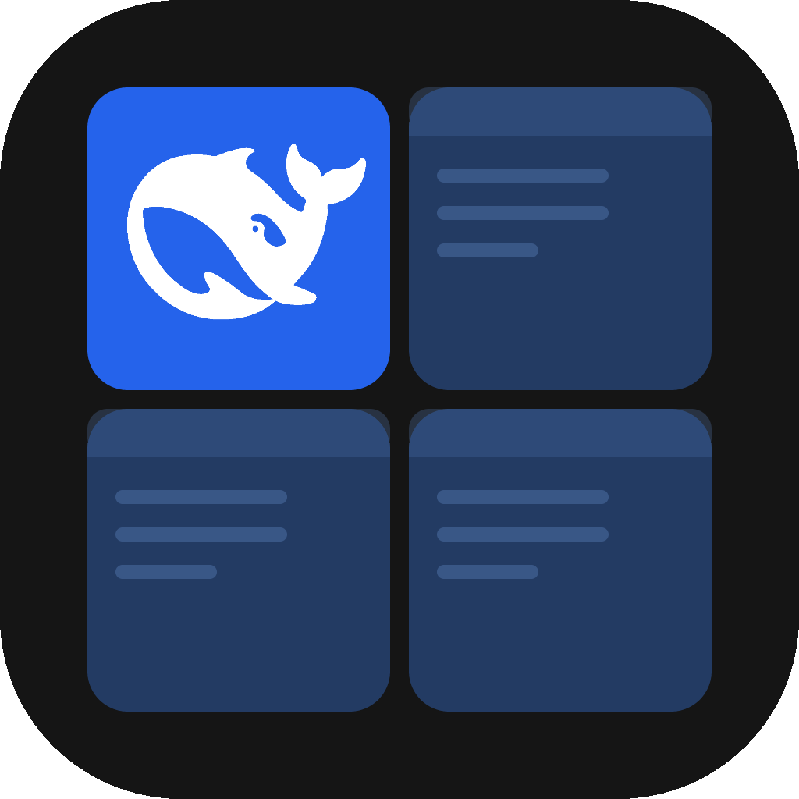
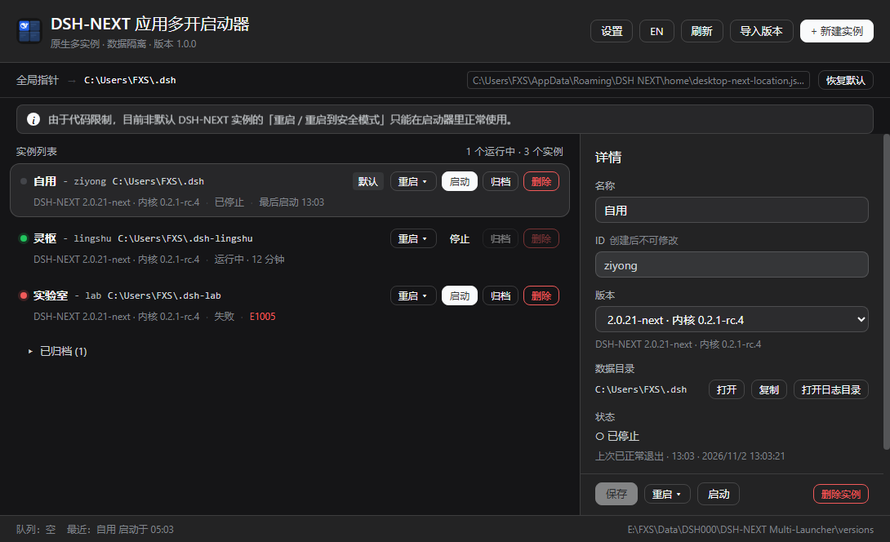
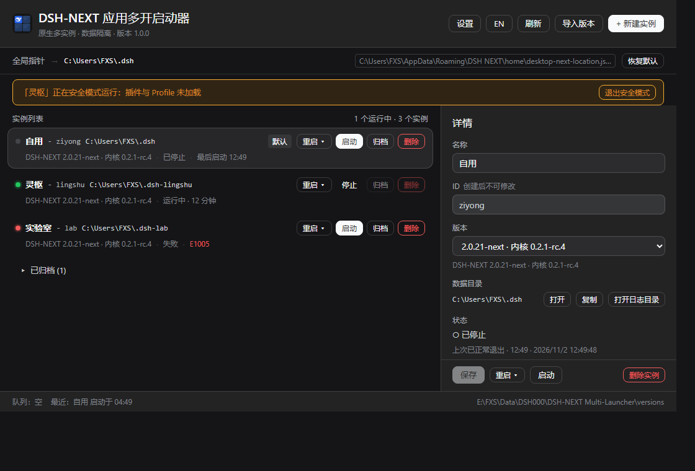

# DSH-NEXT 应用多开启动器



让**同一份 DSH-NEXT 安装**跑出多个互不干扰的实例：**真窗口、真托盘、真 Community Market**，
不是 webview 套壳。每个实例有自己的数据目录（home）与会话数据，双击桌面图标仍然进你的日常环境。

[](https://github.com/XinSpark/dsh-next-multi-launcher/actions/workflows/ci.yml)
[](LICENSE)
[](#)



## 为什么需要它

DSH-NEXT 启动时读一个**全局指针文件**（`%APPDATA%\DSH NEXT\home\desktop-next-location.json`），
指针里的 `home` 决定这次进哪个数据目录，而进程启动时会顺带把 `userData` 指到
`<home>\electron-user-data` —— Electron 的单实例锁以 userData 为身份，所以
**不同 home = 两把不同的锁 = 两个实例都能是 primary**。

指针同一时刻只有一个值。于是手工多开要反复改文件，且启动期间不能并发。启动器做的事，
就是把"写指针 + 启动进程 + 失败回滚 + 成功后还原"串成一条**串行管道**。

## 特性

| 能力 | 说明 |
|---|---|
| **多实例** | 每个实例独立名称、ID、home、DSH-NEXT 版本；支持归档、删除、备注 |
| **串行启动队列** | 同一时刻只启动一个，避免指针互相覆盖；超时/版本无效/启动即退出/取消 一律回滚指针 |
| **版本树** | 用目录链接（junction）登记已解包的安装目录，不复制任何文件 |
| **重启** | 「重启 / 重启并进入安全模式 / 重启并退出安全模式」，安全模式状态可识别 |
| **停止** | 优雅退出 → 超时 → 强制结束整组（含 host 子进程） |
| **权限** | 关键目录不可写时自动以管理员重启，界面提供手动入口 |
| **原生对齐** | 配色与尺寸 token 从 `app.asar` 抽取（1158 个），`verify-tokens` 门禁防止漂移 |
| **可验证** | 46 项 Rust 单测、15 项端到端断言（替身进程）、UI 自动化检查 |

## 快速开始

### 1. 准备 DSH-NEXT

安装或解包一份 DSH-NEXT，目录里要有 `DSH NEXT.exe` 与 `resources\app.asar`。

### 2. 运行启动器

- **下载**：从 Releases 取 `DSH-NEXT-Multi.exe`；
- **源码构建**：见[构建与测试](#构建与测试)。

> exe 未做商业代码签名，首次运行 SmartScreen 可能提示 —— 点「更多信息 → 仍要运行」。
> 想消除「未知发布者」可本地签名：`pnpm sign`（见[发布](#发布维护者)）。

### 3. 三步用起来

1. 点「导入版本」，选中 DSH-NEXT 的安装目录；
2. 点「新建实例」，起个名字，数据目录留空即用默认位置；
3. 点「启动」。

## 核心概念

| 概念 | 含义 |
|---|---|
| **指针** | DSH-NEXT 的全局文件，决定下次启动进哪个数据目录；启动器临时改写并在成功后还原 |
| **home** | 实例的数据目录。默认 `<数据目录树根>\.dsh-<id>`，可自由修改 |
| **默认环境** | 设置里的「默认数据目录」；双击桌面图标应进入的环境 |
| **版本树** | `versions\<tag>` 目录链接，指向已解包的 DSH-NEXT 安装目录 |
| **实例** | 名称 + ID + home + 版本的组合，存为 `instances\<id>.json` |

## 使用

### 列表与详情

实例行给出状态（运行中 / 已停止 / 排队 / 失败）、版本、home 与上次启动时间；
选中后在右侧可改名称、版本、home、备注。

### 重启（两处入口）

实例行与详情面板底部各有一个「重启 ▾」，都在【启动/停止】**之前**，**两项**：
「重启」+ 按当前状态二选一（进入 / 退出安全模式）。

重启期间顶部显示「正在重启「X」…」；实例运行在安全模式时，顶部常驻提示条并带「退出安全模式」按钮。



### 顶部提示（单行轮播）

指针栏下方有一条常驻提示，单行轮播、每条 30 秒：

1. 非默认实例的「重启 / 重启到安全模式」只能在启动器里正常使用；
2. 启动时若弹出「数据目录变更」，点「继续」即可。

## 能力边界

**能保证**：数据隔离（会话 / Bot / 凭据 / 日志 / 插件 profile / 窗口状态按 home 各一份）；
多实例同时运行互不抢锁；启动失败一律回滚指针；删除数据目录前有安全网
（盘根 / `%USERPROFILE%` / `%APPDATA%` / 默认 home / 启动器数据目录一律拒绝）。

**不保证**：

| 项 | 说明 |
|---|---|
| 非默认实例在 DSH 内部重启 | 会重读全局指针，落到默认实例；重启请用启动器「重启 ▾」 |
| 多个非默认实例同时运行时的重启 | 指针全局唯一，只有最后启动的那个能正确重启 |
| Agents Anywhere 账号隔离 | 切 home 不隔离 AA 登录与设备绑定，跨实例共享 |
| 内核独立 | 壳与 `@deepseek-ai/dsh` 恒同版本，只有"壳版本"一个旋钮 |
| 同 home 多实例 | 两个 writer 会损坏会话；启动器直接拒绝（E1003） |
| 自动更新管理 | 只提示风险，不改 `app-update.yml`，不写 DSH 安装目录 / 注册表 / 快捷方式 |
| SmartScreen 红色拦截 | 自签名无效，需 EV 证书或信誉积累 |

## 文档

| 想看什么 | 去哪 |
|---|---|
| 全部文档导航 | [docs/README.md](docs/README.md) |
| 设计与取舍 | [docs/设计说明.md](docs/设计说明.md) |
| 实施计划与验收矩阵 | [docs/实施计划.md](docs/实施计划.md) |
| 架构与数据流 | [docs/reference/architecture.md](docs/reference/architecture.md) |
| 数据格式（`app.json` / 实例 / 指针） | [docs/reference/data-format.md](docs/reference/data-format.md) |
| 错误码 `E1000`–`E1012` | [docs/reference/error-codes.md](docs/reference/error-codes.md) |
| 配置项与环境变量 | [docs/guide/configuration.md](docs/guide/configuration.md) |
| 故障排查 | [docs/guide/troubleshooting.md](docs/guide/troubleshooting.md) |
| 踩过的坑（症状→根因→证据） | [docs/experience/](docs/experience/README.md) |
| 项目反馈索引 | [docs/feedback/](docs/feedback/README.md) |
| 验收记录 | [docs/acceptance.md](docs/acceptance.md) |
| 环境取证 | [docs/env-check.md](docs/env-check.md) |

## 构建与测试

环境：Node ≥ 20、pnpm ≥ 9、Rust ≥ 1.77（MSVC 工具链）、WebView2。

```powershell
pnpm install
pnpm tauri dev                    # 开发（Vite + WebView 热更新）
pnpm check                        # svelte-check（0 error 是门槛）
pnpm build                        # 只构建前端
pnpm verify                       # 设计 token 门禁
cargo test --manifest-path src-tauri/Cargo.toml
node tools/e2e.mjs                # 端到端（替身进程，15 项断言）
node tools/ui-check.mjs           # UI 检查（需先 pnpm dev）
pnpm tauri build --no-bundle      # 出 exe
```

### 设计 token 门禁

前端颜色只能来自 `var(--dsw-*)`，且变量必须存在于 `design/tokens.lock.json`
（从 `app.asar` 抽取的 1158 个 token 锁）。`pnpm verify` 拦四类问题：
未登记变量、硬编码颜色、token 名拼写、素材文件被改动。

## 发布（维护者）

```powershell
# 1) 三处版本号保持一致：package.json / src-tauri/Cargo.toml / tauri.conf.json
# 2) 构建并复制便携 exe
pnpm tauri build --no-bundle
Copy-Item src-tauri\target\release\DSH-NEXT-Multi.exe . -Force
# 3) 签名（自签名，消除「未知发布者」）
pnpm sign
# 4) 打 tag
git tag -a v1.0.0 -m "v1.0.0"
```

> 换图标后必须 `cargo clean -p dsh-next-multi-launcher --release` 再构建，
> 否则 exe 内嵌图标不会更新（见 [docs/experience/04-图标与缓存.md](docs/experience/04-图标与缓存.md)）。

## 贡献

见 [CONTRIBUTING.md](CONTRIBUTING.md)。安全问题请按 [SECURITY.md](SECURITY.md) 私下报告。

## 许可

[MIT](LICENSE)。图标中的鲸鱼剪影取自 DSH-NEXT 的官方图标资源，仅用于表明本工具与
DSH-NEXT 的配套关系；DSH-NEXT 本身的许可与版权归其作者所有。
